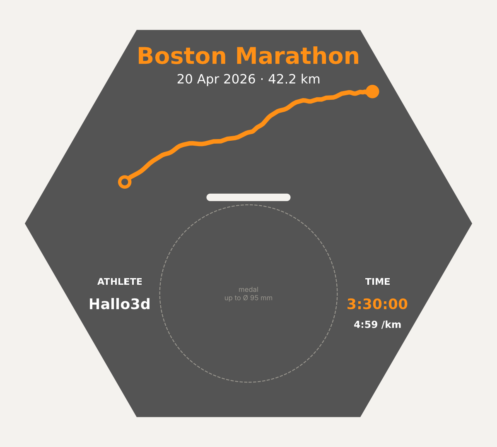

# GPX Medal Tile

Turn a GPX track into a wall-mounted hex tile for 3D printing that shows your route **and** holds your finisher medal. Designed for the Bambu Lab P1S.



- Raised route in orange, GPS noise is smoothed out automatically
- Start as a ring. On loops the ring is also the finish; on point-to-point courses the finish is a filled dot
- Race name (orange), date and distance at the top, athlete name on the left, finish time (orange) and pace on the right
- Ribbon slot (45 × 4 mm) for medals of any shape, Ø up to approx. 95 mm, ribbons 20–40 mm wide
- Wall frame with the same outer size as the tile. 6 pins carry the tile, 4 snap latches hold it: click it on, pull firmly to take it off again. No glue, no magnets
- Expandable honeycomb wall: frames are joined with dovetail keys (inserted from the front), each tile can be swapped on its own. 0.5 mm gap between neighbours as print tolerance
- Ribbon clamp (stepless medal height) and ribbon winder with spring clips (stores the excess ribbon)

Also generated: the wall frame (3 countersunk screw holes), ribbon clamp, ribbon winder, 2 winder clips and 6 connector keys. Every tile needs its own frame, clamp, winder and clips.

## Download (Windows, no Python needed)

Get `gpx_medal_tile_windows.zip` from the [Releases](../../releases) page, unzip it and drag your GPX file onto `gpx_medal_tile.exe`. The console asks for race name, athlete name and finish time; the files are created next to your GPX.

To use your own Bambu Studio settings, put your `bambu_project_settings.config` next to the `.exe` (see "Printing on the P1S").

## Installation with Python (once)

1. Install Python 3.10 or newer (python.org; on Windows tick "Add to PATH" during setup).
2. On first run, `make_tile.bat` installs the packages automatically. Manually:
   `python -m pip install -r requirements.txt`

## Usage

**Easy (Windows):** drag your GPX file onto `make_tile.bat`. You will be asked for race name, athlete name and finish time (press Enter to accept the value read from the GPX).

**Command line:**
```
python gpx_medal_tile.py run.gpx --race "Vienna City Marathon" --name "Alex" --time 3:28:45
```

| Option | Meaning |
|---|---|
| `--race` | race name (shrunk automatically if it is too long) |
| `--name` | athlete name |
| `--time` | finish time `h:mm:ss`, default is the duration from the GPX |
| `--date` | date as printed, e.g. `"12 Apr 2026"`, default from the GPX |
| `--distance` | official distance in km, e.g. `21.1`, default from the GPX |
| `--extra` | extra line below the name, e.g. `"Rank 87"` |
| `--no-pace` | hide the pace |
| `--smooth` | GPS track smoothing in mm (default `0.9`, `0` = off, `1.5` = very smooth) |
| `--rotate` | rotate the route (degrees) if it looks better another way |
| `--no-frame` | skip wall frame and keys (only if you already printed a spare frame); clamp, winder and clips are always generated |
| `--out` | output folder, default is `output_<race name>` next to the GPX |

GPX exports from Strava, Garmin, Komoot etc. work.

## Output

| File | Purpose |
|---|---|
| `*_tile_multicolor.3mf` | ready Bambu Studio project: plate 1 = tile (3 colours), plate 2 = wall frame, ribbon clamp, ribbon winder, clips, keys |
| `*_1_tile_base.stl` | base plate |
| `*_2_text_white.stl` | white text |
| `*_3_route_time_orange.stl` | race name, route, start/finish, finish time |
| `*_tile_single_color.stl` | everything merged, for printing with filament-change pauses |
| `wall_frame.stl`, `ribbon_clamp.stl`, `ribbon_winder.stl`, `winder_clips_2x.stl`, `connector_keys_6x.stl` | accessories |
| `*_preview.png` | preview of the front |

## Printing on the P1S

The tile is printed face up and needs no supports. Recommended: 0.4 mm nozzle, PLA, textured PEI plate.

**With AMS:** open `*_tile_multicolor.3mf`. It is a complete Bambu Studio project with two plates:

- **Plate 1:** the tile as one object with 3 parts; filament 1 (grey), 2 (white) and 3 (orange) are already assigned. The prime tower is placed at the back left (x 4, y 213), clear of the tile.
- **Plate 2:** wall frame, ribbon clamp, ribbon winder, winder clips and connector keys, all in filament 1. The frame is printed wall side down; the snap latches and pins point up and need no supports.

Printer, process and filament settings come from `bambu_project_settings.config` next to the script. It was taken from a project saved in Bambu Studio (P1S 0.4 nozzle, Bambu PLA Basic, 0.08 mm Extra Fine). To use your own settings: set up a project in Bambu Studio, save it, open the `.3mf` as a ZIP and copy `Metadata/project_settings.config` next to the script under that name. Without this file the script writes a standard 3MF (Bambu Studio then loads geometry and colours only).

Alternative: drag the three colour-part STLs into Bambu Studio at the same time and answer "load as a single object with multiple parts?" with Yes.

**Without AMS:** load `*_tile_single_color.stl` and add two pauses / filament changes in the layer preview:

| Height | Filament |
|---|---|
| up to 5.0 mm | grey (base) |
| from 5.0 mm | white (text, lower layers of the orange parts) |
| from 5.8 mm | orange (race name, route and time are taller, so only orange is visible on top) |

## Assembly

**Frames (one per tile)**
1. First frame: hold it against the wall (flat side with the 3 countersunk holes towards the wall), level it, mark the 3 holes through the frame, drill, screw it on with countersunk screws (Ø 4 mm, head up to 8.5 mm).
2. Next frame: put it next to the first one, edge to edge. Press a connector key from the front into the two pockets that meet at the shared edge. The key holds both frames exactly in the grid.
3. Use the new frame as drilling template: mark its 3 holes, take it off (the key stays in the first frame), drill, put it back with the key, screw it on.

**Medal (on the back of the tile)**
1. Push the ribbon loop through the slot from the front.
2. Pull it at the back until the medal hangs where you want it. This is stepless.
3. Press the ribbon clamp into the two holes right below the slot (ridges towards the tile). It pinches both ribbon layers against the tile, so the medal height is fixed.
4. Put the ribbon winder into the remaining ribbon loop and roll the loop up on the narrow waist of the winder, up to just below the clamp.
5. Push a winder clip over the wound card from its long edge (for wide ribbons use both clips, left and right). The clip presses the ribbon onto the card, so it cannot unwind. The card hangs below the clamp, hidden inside the frame.

**Tile**
1. Put the tile onto the frame: the 6 pins go into the corner holes, then press until the 4 snap latches click. The pins carry the tile and medal, the latches hold it against the frame.
2. To swap the tile, pull it off firmly and straight.

Fit: pins 0.3 mm clearance per side (they are taller than the latches, so they guide the tile first), clamp pins are slotted press-fit pins, neighbouring hexes have a 0.5 mm gap. If a fit is too tight or too loose on your printer, adjust `loc_pin_d`, `pin_d` or the `snap_*` values in the `P` dictionary at the top of the script. Print one frame and one tile first and test the fit before printing a whole wall.

## Privacy

GPX files contain your start location (often near home), date and time. Do not commit your own GPX files to a public repository. `example.gpx` is a synthetic, simplified Boston-style route (not the official course), created by `make_example_gpx.py`.

## License

[PolyForm Noncommercial License 1.0.0](LICENSE.md): free for personal use and for noncommercial organizations (e.g. running clubs, schools, charities). **Commercial use is not permitted**, including selling tiles made with this tool. For commercial licensing, open an issue.

## Building the exe yourself

The GitHub Action in `.github/workflows/build-exe.yml` builds and tests the Windows exe on every push. Pushing a tag such as `v1.0.0` attaches the ZIP to a release automatically.
